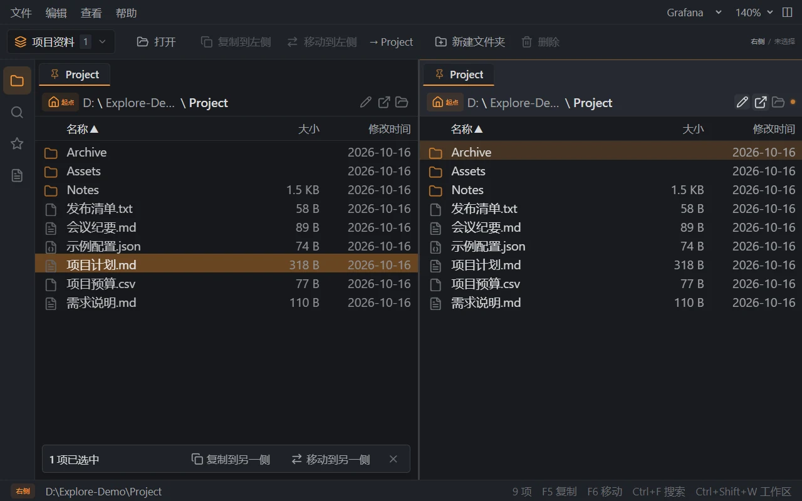

# Explore

A Windows file manager for finding, previewing and organizing files without
losing your place.

[Download for Windows](https://github.com/saramand9/prj-super-explore/releases/tag/v1.0.3)
 | [Getting started](#getting-started)
 | [Contributing](CONTRIBUTING.md)
 | [Security](SECURITY.md)



*Real application screenshot using synthetic files in a dedicated demo directory.
The current interface is primarily Chinese; this README and contributor-facing
guides are in English.*

> Explore's original code and documentation are licensed under the MIT License.
> This source repository is public. Release 1.0.2 includes the Electron security
> hardening described below. See [License](#license) and the
> [maintainer readiness review](docs/maintainers/open-source-readiness.md).

## Why Explore?

- **Keep a workspace for each project.** Restore folders and tabs in both panes
  when switching tasks.
- **Find Chinese filenames with pinyin.** Search by full pinyin, initials or mixed
  input within a directory and its subdirectories.
- **Organize side by side.** Open the same directory in two independent panes,
  then keep one as your source while navigating to a destination in the other.
- **Inspect without switching applications.** Preview code, Markdown, CSV and
  logs, and navigate literal full-text search results.
- **Work with tabs and shortcuts.** Pin, clone, rename and search tabs; copy or
  move selected files to the opposite pane.
- **Make the interface comfortable.** Choose among ten desktop themes and adjust
  text scale and pane layout.

Explore is a local file manager, not a backup service. External plugins are
trusted local code, not sandboxed extensions.

## Download

The Windows x64 release prepared by this source is **1.0.3**, dated **October 17, 2026**.

- [Release notes and Windows installer](https://github.com/saramand9/prj-super-explore/releases/tag/v1.0.3)
- [SHA-256 checksum file](https://github.com/saramand9/prj-super-explore/releases/download/v1.0.3/SHA256SUMS.txt)

Compare the checksum file with a downloaded installer in PowerShell:

```powershell
Get-FileHash -Algorithm SHA256 '.\Explore-Setup-1.0.3-windows-x64.exe'
```

Installers are currently unsigned. A checksum is useful for integrity checking
but is not an independent publisher signature. A release link becomes available
only when its draft passes acceptance and is explicitly published. Rebuilding a
branch or tagging it does not itself publish a new binary.

### Updates (1.0.3 and later)

The Windows build checks this repository's public GitHub Releases ten
seconds after startup and every six hours. Use **帮助 → 检查更新...** to open the
update panel. Download and restart/install each require your action. Closing the
application does not install an update. Workspace/settings save failures and
active file operations prevent installation; failed downloads are not executed.

The published 1.0.2 binary has no updater. Install the first updater-enabled
release manually once; later releases can use the built-in update panel.
This is a full installer update with a restart, not live replacement of running
JavaScript. GitHub connectivity is required; no account or token is needed.
See [update behavior and release acceptance](docs/updates.md).

### System requirements

- Windows 10 or later, x64.
- 4 GB RAM recommended.
- Approximately 500 MB of available disk space.

Node.js and pnpm are needed to build from source, not to use the installer.
macOS and Linux releases are not currently validated or distributed.

## Getting started

1. Install and launch Explore.
2. Open a directory in each pane, or open the same directory in both panes to
   organize its contents independently.
3. Create a named workspace to keep that task's folders and tabs together.
4. Use filename search to locate a file, or full-text search to inspect contents.
5. Preview a result, then copy or move it only after checking the destination.

Useful shortcuts:

- `Ctrl+O`: open a folder.
- `Ctrl+T`: create a tab.
- `Ctrl+P`: search tabs.
- `Ctrl+Shift+W`: search and switch workspaces.
- `Ctrl+W`: close the current preview or tab.
- `Ctrl+F`: open search for the current context.
- `Ctrl+Shift+F`: open full-text search.
- `F5` / `F6`: copy / move selected files to the opposite pane's folder.

Internal dragging copies by default. Hold Shift to move; Ctrl explicitly keeps
copy behavior. Full-text search is literal, not a regular-expression interface.
Read [data, recovery and operational limits](docs/data-and-safety.md) before
testing with important files.

## Build from source

Requirements: Windows x64, Node.js 22 or later and **pnpm 10.31.0**.

```powershell
git clone https://github.com/saramand9/prj-super-explore.git
cd prj-super-explore
pnpm install --frozen-lockfile
pnpm dev
```

The repository is public; cloning does not require maintainer-granted access.

```powershell
pnpm typecheck
pnpm lint
pnpm format:check
pnpm test:unit
pnpm test:e2e
pnpm test:commit-policy
pnpm check:commits
pnpm build
```

For a packaged application or installer:

```powershell
pnpm pack:dir
pnpm pack:win
pnpm test:package
```

Artifacts are written to `apps/desktop/dist-electron/`. The CI workflow runs
Windows checks. Version tags additionally build a draft GitHub Release; a
maintainer must review and publish it explicitly. See [release procedure](docs/releasing.md).
See [development and packaging](docs/development.md) for isolated tests,
ripgrep verification and troubleshooting.

## Project structure

```text
apps/desktop/       Electron main process, preload, React UI and tests
packages/shared/    Shared IPC, configuration and plugin types
docs/               User, developer and maintainer documentation
scripts/            Repository checks and benchmark utilities
```

## Documentation

- [Development and validation](docs/development.md)
- [Local data, recovery and operational limits](docs/data-and-safety.md)
- [Scan benchmark methodology](docs/scan-benchmark.md)
- [Contributing and commit conventions](CONTRIBUTING.md)
- [Security policy](SECURITY.md)
- [Community code of conduct](CODE_OF_CONDUCT.md)
- [Third-party notices and asset provenance](THIRD_PARTY_NOTICES.md)

## Contributing and support

Use the issue templates for reproducible bugs and focused feature proposals.
Provide synthetic reproduction files and review logs/screenshots for private
paths before sharing them. Do not report vulnerabilities publicly; follow
[SECURITY.md](SECURITY.md).

Commit subjects and bodies use English
[Conventional Commits](https://www.conventionalcommits.org/en/v1.0.0/).
See [CONTRIBUTING.md](CONTRIBUTING.md) for local checks, the optional commit hook,
pull request expectations and MIT contribution terms.

## License

Explore's original code and documentation are licensed under the
[MIT License](LICENSE). Keep the copyright and permission notice when
redistributing copies or substantial portions of the software.

Bundled raster icons with unresolved provenance are excluded from this MIT
license representation until their rights are verified. Before public launch,
the maintainer must still confirm contributor/employer rights and resolve or
replace those assets.

Third-party packages and bundled components retain their own licenses. See
[THIRD_PARTY_NOTICES.md](THIRD_PARTY_NOTICES.md). This notice is not a substitute
for the upstream license texts required for binary redistribution.
